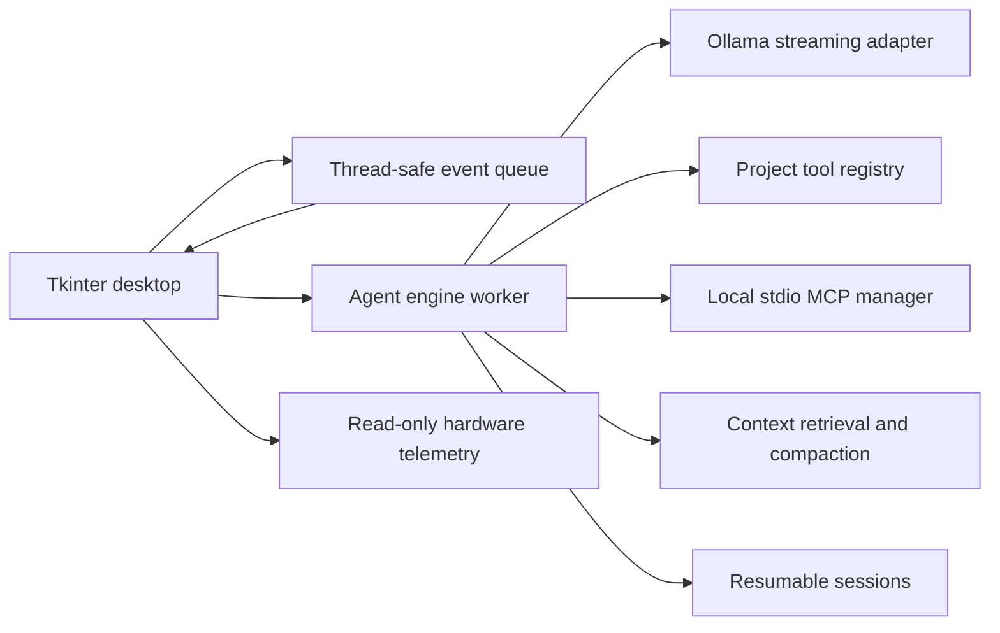

# Local Agent Desk

A Windows-first, single-agent local coding workbench using Ollama. The exact default is `hf.co/mradermacher/Ornith-1.5-9B-uncensored-GGUF:Q4_K_M`.

The desktop is organized around the work loop: a project and recent-session rail, a central conversation/composer, and an inspector for plans, tool activity, and Git changes. Run settings live in a dedicated window so high-context and approval controls remain available without crowding the conversation. This interface redesign is source-implemented but still needs visible desktop inspection and full user-flow acceptance.

## Start

1. Install Python 3.10+ (Tkinter enabled) and Ollama.
2. Keep the Ollama service running. The app does not start, stop, unload, or pull models.
3. Run `Start Local Agent Desk.bat` or `python app.py`.
4. Choose a project folder, select one installed model, review the context setting, and enter a task.

The app never changes OpenCode configuration. It does not load a model on launch. It requests the chosen context (defaulted from model metadata, up to the full advertised context) and reports Ollama's actual allocated context. If the runtime rejects or cannot allocate it, the request shows the error; the app does not silently reduce context. Reasoning controls are left unset. Inference has no response deadline; Cancel closes only the current request. The app does not stop Ollama or unload a model.

## Features

- General installed Ollama model selection, temperature, output-token, and context settings.
- Streaming conversation with time-to-first-token and elapsed phase status.
- Project-bounded file listing, search, reads, approved file writes, unified patches, and argv-only commands.
- Ask/edit/plan access modes; per-action approval by default and optional per-task approval.
- Project instruction discovery (`AGENTS.md`, `CLAUDE.md`, `GEMINI.md`, GitHub Copilot instructions) and on-demand project/user skill loading.
- Query-ranked relevant file retrieval, conservative conversation compaction, and explicit input budget reporting.
- Resumable JSON sessions under `%LOCALAPPDATA%\LocalAgentDesk\sessions`.
- Local stdio MCP configured in `%LOCALAPPDATA%\LocalAgentDesk\mcp.json`; optional official SDK with `python build.py --install-mcp`.
- Read-only CPU/RAM/GPU and Ollama-loaded context telemetry.
- Project file preview and an inspector for task plans, tool activity, and Git diffs.
- CLI is not bundled in this fresh product; desktop app is the V1 application surface. No clouds or subagents in V1.

## Security and boundaries

Project file tools resolve paths under the selected workspace and reject symlinks. Shell strings are not accepted; commands use argv with `shell=False`. Command approvals explain commands run with your Windows account permissions. MCP servers execute local subprocesses specified by the user in the MCP config; add only commands you trust. MCP calls also ask for approval. Sessions store conversation content locally, potentially including code excerpts.

## Tests

Run the mocked suite with `python -m unittest discover -s tests -v`. Tests do not invoke inference. The authorized live check was interrupted before it produced a coding result; the test runner briefly requested 32,768 context on the already-loaded exact tag, then restored the prior 65,536 allocation. Do not use that attempt as a speed or coding baseline.

## Architecture

## Roadmap

- Benchmark optional Ollama KV cache settings only in controlled runs.
- Consider llama.cpp only if repeatable measurements show material gains.
- Add subagents only after the single-agent app is reliable.
