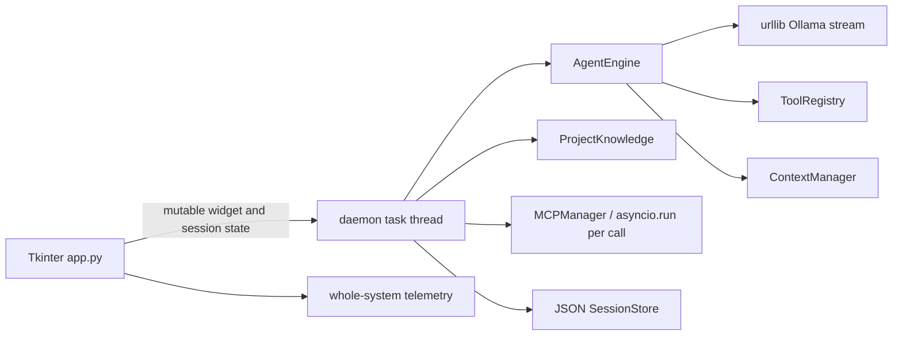

# Local Agent Desk — Source Audit and Product Redesign Plan

Date: 2026-10-30  
Audit mode: read-only source inspection; no model request, project write, command approval, test execution, or app code change was performed for this audit.  
Baseline: `2e10b37` (`chore: checkpoint current local agent desk prototype`), clean worktree.

## Executive finding

This is an early functional prototype, not a reliable full-project development platform yet. The highest risk is that UI state, session state, and the workspace used by a background turn are not an immutable snapshot. A workspace/session change while a task is starting can redirect what that task inspects or modifies. Cancellation, MCP event-loop ownership, command isolation, context accounting, and UI lifecycle have additional gaps. The current visual is a fixed dark two-column control panel, not a developed coding-workbench interaction model.

No live behavior is claimed by this source audit. The previous implementation-status document records earlier checks, but those results were not rerun during this review.

## Findings

Severity: **P0** means block real-project use; **P1** means core reliability/security gap; **P2** means substantial product or usability gap.

### P0 — A running task does not own an immutable project/session snapshot

`app.py:_send` starts a worker that later reads `self.workspace`, `self.access_var`, `self.approval_var`, `self.mcp_tools`, and mutable session state. The UI leaves the folder, session, model, context, and approval controls usable while the worker runs. Choosing another folder invokes `_new_session`, replacing `self.session_state`, while the earlier worker continues. This permits one turn's context, tool registry, approvals, UI output, and saved state to refer to different projects. Capture a frozen `TurnContext` before starting and lock or explicitly queue project/session changes until that turn ends.

### P0 — Command approval is not a sandbox

`desktop_engine.py:120-128` runs arbitrary model-selected argv with the user's account, network access, environment, and filesystem privileges. `shell=False` prevents shell syntax but does not constrain the child process. A timeout bounds duration only; it does not bound writes or descendants. Per-task approval authorizes subsequent actions without reviewing their changed arguments. Until operating-system isolation exists, make the boundary conspicuous, keep per-action approval as the default, and require granular approval for every process invocation. A real sandbox requires a Windows restricted token / Job Object or a container boundary, path and environment policy, child-process termination, and explicit capability controls.

### P1 — Cancel can miss a request and does not reliably interrupt blocking work

`app.py:_cancel` can run before `self.engine` is assigned (during MCP discovery/project knowledge); only `stop_event` is set, but the subsequently created engine owns a different cancel event. `OllamaRuntime.stream` uses `urlopen(..., timeout=600)` and blocking `readline()`, so the claimed no-deadline behavior still has a ten-minute socket inactivity deadline, and cancel responsiveness depends on closing a response from another thread. `run_command` can block for up to 300 seconds and is not connected to the cancellation event. Use a request controller created before worker startup, a cancellable transport, explicit timeout policy (no fixed generation deadline), and managed subprocess groups.

### P1 — Session lifecycle can show or persist the wrong conversation

`app.py:_new_session` does not clear `session_var`; `_resume_session` appends messages without clearing the chat first. The session selector can therefore point at an earlier run after selecting a new project, and repeated resume duplicates the visible transcript. Completion is emitted inside `AgentEngine.run` before the worker has saved the returned messages; `_poll` may mark the app idle and save while the worker is still finalizing. Define explicit session transitions, clear/restore the view atomically, and have one owner emit the terminal event only after persistence completes.

### P1 — Saved sessions bypass project instructions

`app.py:_send` always passes `state['messages']` to `AgentEngine.run`. The engine only builds its system message (including current `ProjectKnowledge.instructions()`) when no history was provided. New sessions are created with a generic system message in `sessions.py`, so normal saved sessions also take the bypass. Construct/validate system context at every turn, bind it to the selected workspace, and test recovery with changed project instructions.

### P1 — Project traversal is not consistently bounded

`Workspace.resolve` calls `Path.resolve()` before `is_symlink()`, so the final symlink check cannot detect a link that was resolved. Escapes outside the workspace are blocked by the containment check in this method, but internal links are accepted despite the README promise. `rglob` walkers in list/search/retrieval/instruction discovery do not consistently prune symlink directories, junctions/reparse points, or `.gitignore` paths before traversing them. Add one shared, non-following workspace walker and validate reparse points at each path component; cover symlink/junction races and ignore rules.

### P1 — MCP sessions are used across separate event loops and partial startup can leak

`MCPManager.run` calls `asyncio.run` for discovery, each tool call, and cleanup. Those operations create and close different loops while reusing the same async session/stdio streams. Asyncio synchronization/transport objects are loop-affine, so repeated calls and cleanup are not reliable. `discover` stores clients only after initialize/list-tools succeeds; errors partway through enter can leave a child process/session untracked. Give MCP one owned event-loop thread and deterministic startup rollback/shutdown; surface per-server health and errors.

### P1 — Context budgeting does not count the actual request

`ContextManager.estimate` approximates tokens as UTF-8 bytes divided by three, while `compact` counts only message `content`, not tool calls, JSON arguments, tool schemas, system/instruction text outside messages, or runtime framing. It reserves a fixed 8,192 tokens regardless of output-token setting. Retrieval can add up to 18,000 estimated tokens on every turn and scans every eligible file; it ignores `.gitignore` and has no total file/scan budget. These behaviors can exceed actual model context, cause long prefill, or retrieve unintended repository content. Build a complete request-budget view, conservatively account for tools/output, make retrieval bounded/ignore-aware, and show what was included and why. Keep the selected context unchanged and report allocation failures.

### P1 — Tool-call loop can silently lose work and corrupt history

`AgentEngine.run` processes only `calls[:16]`; extra calls are dropped. Invalid JSON arguments silently become `{}`. The custom patch parser does not fully validate unified-diff structure, does not implement file deletion semantics, can partially write a multi-file patch, and normalizes line endings. Tool errors are returned as plain text and the UI can display a terminal success before the worker persists the result. Validate every call, reject unsupported payloads visibly, impose a transparent limit without dropping calls, apply patches transactionally, and model tool outcomes explicitly.

### P2 — UI is a settings-heavy shell instead of a complete development workbench

`app.py:_layout` places workspace, model, context/output, access, approval, telemetry, sessions, and MCP setup in one fixed-width side rail; the main area is a plain text transcript and composer. File/project navigation, changed-file review, task plan, run/approval queue, session metadata, runtime diagnostics, and settings are not organized as coherent user workflows. It relies on fixed dimensions, text colors, and native modal approvals; there is little visual hierarchy or responsive layout. Redesign around the real loop: project and session selection → task conversation → inspect plan/tool activity/changes → approve a specific action → review diff/test output → resume. Use a distinctive, accessible visual language and purpose-built components; do not apply a generic dashboard/template or the frontend-design skill.

### P2 — Status and telemetry overstate what is measured

`telemetry.py` reports system-wide CPU/RAM and NVIDIA `nvidia-smi` output, while the UI presents it as live resources without process attribution; there is no AMD GPU path. The phase is set to `waiting` before each stream, but streamed tokens do not switch it to a clear generating state. Model-info responses can arrive after selection changed and overwrite the context field for the new model. Label scope/source, track request-level first-token/generation phases, and discard stale metadata responses.

### P2 — Session persistence lacks schema migration and workspace recovery

`SessionStore.load` checks only a handful of keys and does not validate message/tool-call shapes, schema versions, model IDs, or whether the workspace still exists. JSON files preserve raw conversation/context with no size policy or recovery UI for corrupt/stale sessions. Add schema migration, validation, backup/recovery, workspace relink, and retention controls.

## Current architecture map

The main redesign seam is a typed application controller and immutable turn snapshot between UI and engine. Keep view rendering on the Tk thread; keep provider, file indexing, MCP, subprocesses, and persistence off it. Have one lifecycle owner coordinate cancellation, completion, persistence, and shutdown.

## Product redesign direction

The app should feel like a focused local coding environment optimized for small, slower models, with compact default context and explicit high-capacity settings—not a settings form wrapped around a chat box.

1. **Project rail:** current project root, project switcher, recent projects, source tree/search, Git status, and session history scoped to the project. Never silently switch the active workspace when resuming a session; show a clear “reopen this project's session” transition.
2. **Conversation center:** readable user/model turns, streaming Markdown/code rendering, elapsed and first-token state, tool activity grouped under the turn, and an always-available composer with attach/context controls.
3. **Review/activity surface:** task plan, files read/changed, patch review, command/test output, pending approvals, and Git diff. Preserve events in the transcript so work is auditable.
4. **Runtime/settings surfaces:** model picker and health in the header; generation settings in a focused popover/page with advertised and allocated context distinguished; MCP, approvals, storage, diagnostics, and hardware scope in dedicated settings. Never imply that context or timeouts were silently changed.
5. **Action flow:** each turn owns an immutable project/model/settings snapshot; tool activity is staged; approval previews exact effects; mutations are attributed to a specific turn; tests are explicit commands and results; cancellation terminates only the active request/child process; completion is emitted after session save.
6. **Visual character:** bespoke, restrained graphite/ink base, warm neutral surfaces, one vivid accent reserved for active work, subtle depth and deliberate spacing, typography with distinct code/UI roles, compact information density, clear keyboard focus, and usable scaling. Avoid the current repeated rounded panel/card treatment and generic neon dashboard aesthetic.

## Remediation sequence and acceptance gates

### Gate 0 — Protect current evidence and define contracts

- Keep the clean baseline commit intact; all future work is committed in small, named commits.
- Define `TurnContext`, lifecycle states, event contracts, path policy, approval policy, and session schema before redesigning view code.
- No real-project/model use until workspace isolation and cancellation gates pass.

### Gate 1 — Correctness and boundaries

- Freeze task inputs; disable or explicitly queue project/session/model changes during a run.
- Repair new/resume/switch transitions and single-owner completion/persistence.
- Make system/project instructions apply after resume.
- Enforce project boundary and no-follow traversal for all tools/retrieval/knowledge.
- Ensure cancel reaches provider and process from the instant a task starts; remove the fixed socket inactivity deadline while retaining connect/health timeouts.
- Replace per-call MCP event loops with one managed loop and cleanup on all failures.

### Gate 2 — Trustworthy tool execution and context

- Action-scoped approval with exact file/command/MCP target details; per-task approval must state and enforce its scope.
- Transactional, validated patch application and explicit tool-call failure reporting.
- Child process limits, cancellation, output truncation indicators, environment controls; never call this a sandbox until OS isolation exists.
- Full context accounting with relevant, bounded, ignore-aware retrieval and an inclusion report; preserve requested context and display actual Ollama allocation.

### Gate 3 — Product-grade UI

- Replace the current layout with the project/conversation/review surfaces above, responsive to realistic Windows sizes and scaling.
- Make approval, cancel, session switch, model change, diagnostics, and recovery visible and keyboard-accessible.
- Use one state-driven renderer so text/tool/progress/error/save events cannot appear out of order or duplicate.

### Gate 4 — Verification and controlled live acceptance

- Expand deterministic tests for the identified races, symlinks/junctions, cancellation, context accounting, MCP loop ownership/rollback, patch atomicity, and session recovery.
- Exercise the actual visible app through hello → task → approval → edits → test output → cancel → save → resume, in a newly created empty disposable project with an explicit workspace assertion at every action.
- Do not treat window construction or mocked provider tests as end-to-end acceptance. Perform a live model run only under the separately approved model/load-preservation constraints; capture first token, generation speed, effective context, and peak RAM/VRAM.

## Unverified / limitations

- No test suite or live provider request was run for this audit.
- The existing window was later brought forward and visually inspected; it was the older source revision, idle, with a `StableTest` workspace and matching session selected. The redesigned source was not loaded into that process or visually inspected. No model request or project write was submitted.
- Command execution currently has the host user's privileges. A redesigned approval dialog alone cannot provide a security sandbox.
- The existing repository contains one baseline snapshot commit with all prototype files. Git cannot reconstruct a per-edit history for work that predates that commit; new changes can be committed incrementally from this point.

## Work started after the audit

The following changes are committed separately after the audit baseline:

- `0c7542a` captures an immutable per-turn snapshot, prevents project/session/model controls from changing during an active turn, clears stale session selection/transcript state, and emits UI completion only after session persistence. A regression test covers snapshot isolation.
- The follow-up reliability commit makes the current workspace system instructions replace stale generic instructions on resumed history and rejects symlinks before path resolution in `Workspace.resolve`; tests cover both cases.
- The MCP reliability commit gives client sessions a dedicated long-lived asyncio loop, rolls back partially initialized server sessions, records per-server discovery errors, and shuts the loop down when the app closes. A regression test verifies separate bridge calls use the same loop.
- The workbench redesign replaces the single settings-heavy rail with a project/session rail, central conversation/composer, and Plan/Activity/Changes inspector; model status remains in the header and run controls move to Preferences. It is source-implemented and syntax-checked, but not yet visually inspected in the running Windows app or accepted through the full task flow.
- Shared project traversal now prunes symbolic-link/junction directories and generated folders before listing, searching, retrieval, preview, or instruction discovery. A regression test verifies a marked linked directory is not descended into.
- Provider streaming no longer has the former 600-second socket inactivity timeout; the UI distinguishes waiting from generation. MCP discovery/calls now accept the per-turn cancellation signal. Approved argv commands use a cancellable child process and have a 3,600-second maximum, with cancellation regression coverage. Every provider tool call now receives a result message; malformed JSON is visible and batches above 16 are explicitly rejected per-call instead of silently dropping tool calls. Per-task approval now warns that the grant covers later actions in that task.
- Context accounting serializes messages and tool schemas and reserves the configured output allowance plus framing headroom. Its UTF-8 byte estimate is conservative rather than a model tokenizer, so it can reject a request earlier than Ollama would; it never changes the requested `num_ctx`.
- Unified diff handling now validates hunk counts/context, stages all file results before applying, supports deletions, and rolls back a multi-file application if replacement fails. Approval uses a scrollable complete action preview rather than truncating long patches or file contents.

These changes address only the listed paths. Direct approved child processes can be cancelled, but process-tree containment / OS isolation, complete request token accounting, and patch transactionality remain open. The redesigned UI also awaits visible inspection and user-flow acceptance. The app remains unsuitable for unrestricted real-project agent work until those gates and a visible end-to-end acceptance are completed.
